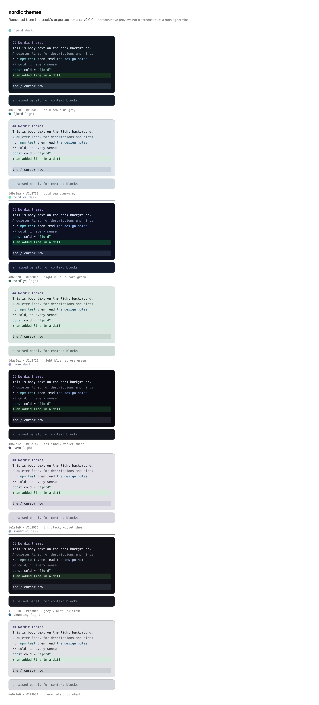
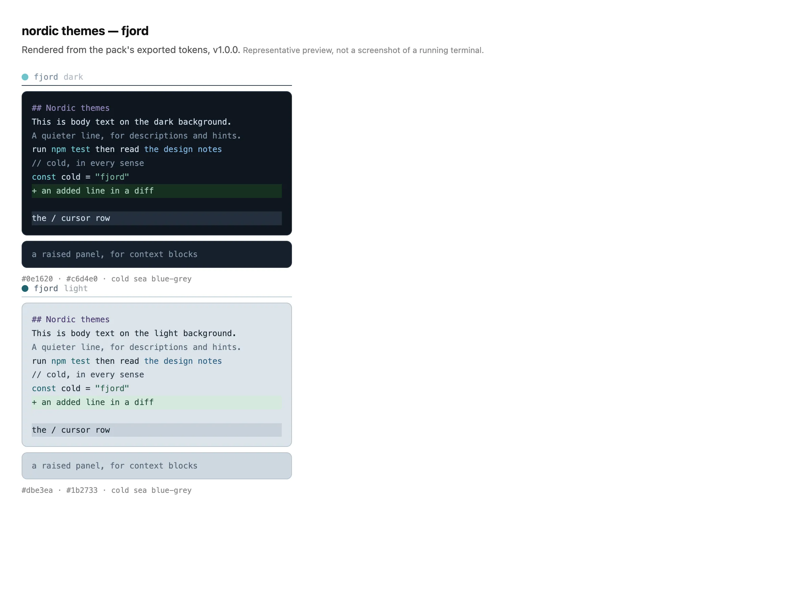
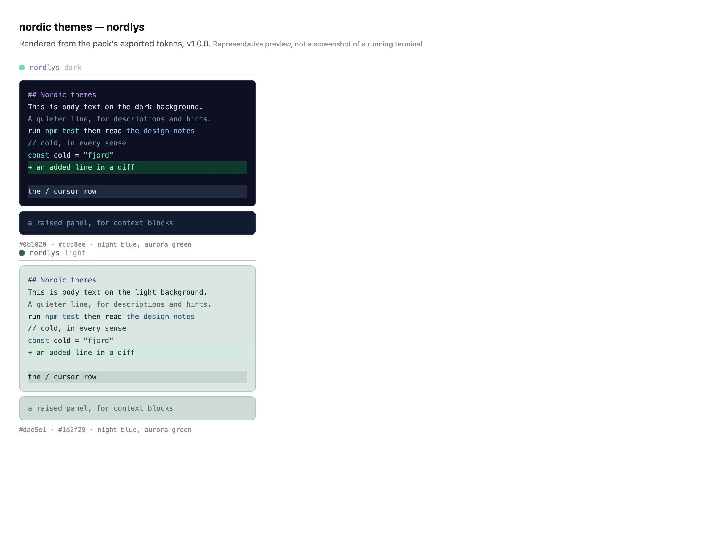
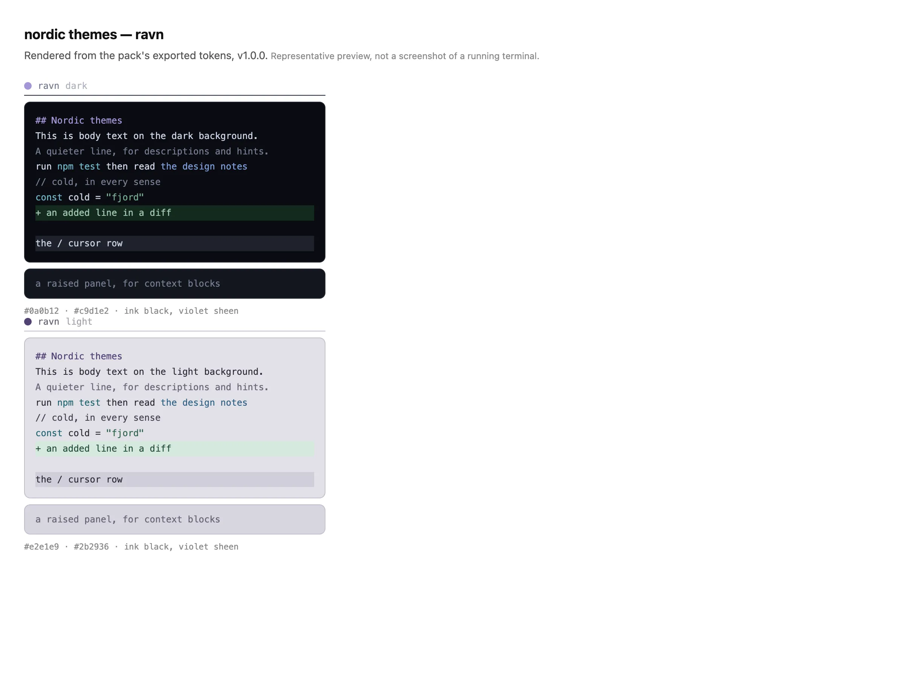
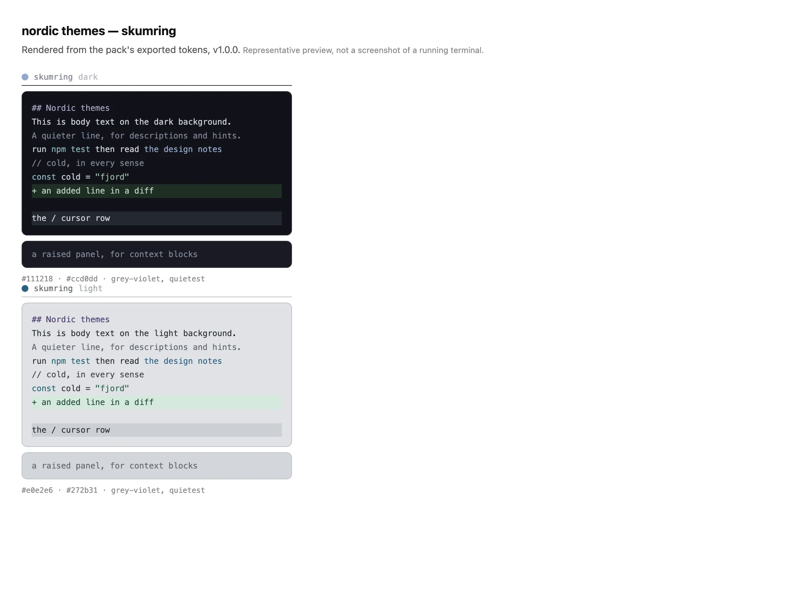

# Nordic themes for OpenCode

An **unofficial** theme pack for the [OpenCode](https://opencode.ai) terminal UI — four themes
named after a Danish day, each with a dark mode and a light one. They are plain JSON theme
files, and the same colours are exported as CSS custom properties, so they work in a web app
too.



*The previews below are rendered from the exported tokens, not captures of the running TUI.*

---

## Install

Copy a theme file into either theme directory — the **filename is the theme name**, so
`fjord.json` becomes the theme `fjord`:

```sh
# for every project
cp themes/dist/fjord.json ~/.config/opencode/themes/

# or for one project only
cp themes/dist/fjord.json .opencode/themes/
```

Then pick it: `Ctrl+P` → **Open settings** → theme, or put it in `~/.config/opencode/cli.json`:

```jsonc
{
  "theme": { "name": "fjord" }
}
```

A theme file carries both modes. Follow your terminal, or lock one:

```jsonc
{ "theme": { "name": "fjord", "mode": "dark" } }   // "dark" | "light" | "system"
```

To try a mode without editing anything:

```sh
OPENCODE_CLI_CONFIG_CONTENT='{"theme":{"mode":"light"}}' opencode
```

If a theme you just added does not appear in the list, restart OpenCode — a new file has to be
discovered. Edits to an existing file reload live.

## The four themes

One day in one cold place.

### fjord — daylight on cold water

Cold sea blue-grey with a teal accent. The flagship: the coldest, and the one that leans
hardest into blue.



### nordlys — the aurora

Night blue with the aurora burning green. The most saturated of the four.



### ravn — the dark hours

Ink black with a raven feather's violet sheen. The darkest.



### skumring — dusk, the light going

Grey-violet, barely any colour at all. The quietest and coldest.



Every theme has a daylight twin, **overcast**: a cool tinted sky rather than a white page, and
tinted per theme — fjord blue-grey, ravn violet, nordlys green-teal, skumring almost
colourless. That tint is the point: four light modes that are recognisably four different
days, instead of one washed-out grey repeated four times.

## The token model

Each theme is eleven colour ramps — `gray`, `red`, `orange`, `yellow`, `green`, `cyan`, `blue`,
`purple`, plus the aliases `accent`, `interactive` and `neutral` — with nine steps each
(`100`…`900`). Semantic roles (`text.base`, `markdown.heading`, `diff.background.added`, …)
reference those steps, so retuning one ramp moves everything that uses it.

Two things are worth knowing:

- **The steps flip between modes.** In dark mode `100` is the lightest step and `900` the
  darkest; in light mode it is the other way round. A role that names `gray.300` stays
  "roughly this light" in both modes because the ramp itself flips.
- **Contrast is checked, not eyeballed.** Body text is held to 4.5:1 and muted text, every
  syntax colour and every diff colour to 3:1, measured against all five surfaces they can land
  on. `npm test` fails if a palette drops below.

## Using it outside OpenCode

`npm run export` writes the same colours twice over, for consumers that are not OpenCode:

| file | what it is |
|---|---|
| `themes/dist/tokens/tokens.json` | every theme, both modes, plus the pack version |
| `themes/dist/tokens/<theme>.css` | CSS custom properties, one property per mode |

The CSS defines every property once per mode, with `:root` carrying dark so a page that does
nothing still gets a complete theme:

```css
:root,
[data-theme="fjord-dark"]  { --fjord-text-base: #c6d4e0; --fjord-blue-500: #4278ad; … }
[data-theme="fjord-light"] { --fjord-text-base: #1b2733; --fjord-blue-500: #4f8fb0; … }
```

```html
<body data-theme="fjord-light"> … </body>
```

Tailwind v4 and anything else that reads custom properties needs no further artifact. OpenCode's
interaction states (`$hovered`, `$focused`, …) are deliberately not exported — they are UI
behaviour, not colour.

## Versioning

One version for the pack, in `themes/package.json`, following SemVer as if the tokens were an
API:

| bump | when |
|---|---|
| **major** | a token or theme is removed or renamed, or an existing token changes meaning |
| **minor** | a new theme, a new exported token, or a new output format |
| **patch** | a colour retune, tests, docs |

**A colour change is a patch.** Consumers bind to token names, not to exact hex, so retuning
`--fjord-blue-500` does not break anyone. Changes are listed in [CHANGELOG.md](CHANGELOG.md).

## How the palettes are defined

`themes/src/palettes/<theme>.mjs` is data, not code: five anchors per ramp per mode
(`100/300/500/700/900`), and the four steps in between are interpolated in OKLab so the ramp
keeps its hue instead of drifting through grey. Everything else in the file is bindings.

```
themes/
  src/
    contract.mjs   the token tree and the value rules
    color.mjs      sRGB ↔ OKLab, WCAG contrast
    ramp.mjs       five anchors → nine steps
    theme.mjs      a palette spec → a complete theme file
    validate.mjs   completeness, ramp direction, the contrast matrix
    build.mjs      validate, write dist/<name>.json, --install
    export.mjs     write dist/tokens/
    palettes/      the four themes — one file each
  tools/           dev-only: preview renderer, loader check
  test/            node:test, palette-agnostic
  docs/reference/  the extracted OpenCode theme contract
```

Building from source needs Node 20.19+ and nothing else — there are no dependencies:

```sh
cd themes
npm run build          # validate and write dist/<name>.json
node src/build.mjs --install   # …and copy to ~/.config/opencode/themes/
npm test               # 68 tests: values, ramps, contrast
npm run export         # dist/tokens/
```

## How it was built

The theme format is not documented anywhere machine-readable, so the contract was extracted
from the OpenCode binary itself: the token tree, the value rules and the loader's own resolver,
which `npm run check:loader` replays against the built files — the only check that proves a
theme actually loads. Every palette was then designed by hand, from approved anchor colours, and
held to the contrast floors above.

## Licence

[MIT](LICENSE). The theme *files* in `themes/dist/` are yours to use however you like.

Not affiliated with, endorsed by, or part of the OpenCode project — just a theme pack that
happens to live in a repository called `opencode`.
